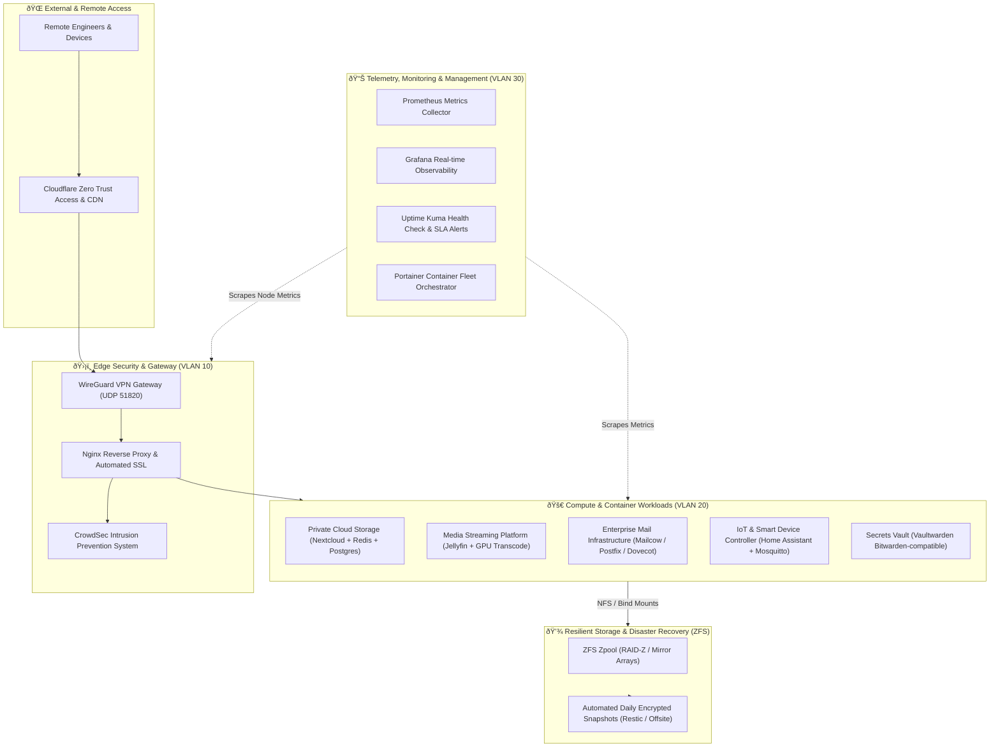

# ☁️ My Private Cloud: AWS-Inspired Self-Hosted Infrastructure

[](./ARCHITECTURE.md)
[](./docs/security-architecture.md)
[](./docs/disaster-recovery.md)
[](./LICENSE)

A production-grade, self-hosted private cloud infrastructure modeled after AWS cloud architecture. Built with enterprise principles: hardware virtualization, software-defined networking, isolated VLANs, zero-trust security perimeters, automated observability, and multi-tier disaster recovery.

---

## 🏛️ High-Level System Architecture



---

## 📂 Repository Layout

```text
my-private-cloud/
├── README.md                          # Central project overview
├── ARCHITECTURE.md                    # In-depth architectural blueprint & specifications
├── ROADMAP.md                         # Milestones and future roadmap
├── docs/
│   ├── infrastructure-overview.md     # Server hardware inventory, Proxmox virtualization
│   ├── network-topology.md            # Subnets, VLAN configuration, routing tables
│   ├── security-architecture.md       # Zero trust, SSH hardening, SSL, CrowdSec
│   └── disaster-recovery.md           # 3-2-1 backup policies, RPO/RTO metrics, test recovery
├── deployment/
│   ├── docker-compose.yml             # Unified services orchestration
│   └── .env.example                   # Environment variable template
├── automation/
│   └── backup.sh                      # Automated backup script with Slack/Telegram webhook
├── monitoring/
│   └── prometheus.yml                 # Prometheus scrape targets configuration
└── blogs/
    ├── 01-building-private-cloud.md   # Comprehensive architectural case study
    └── 02-zero-trust-security.md      # Security hardening deep dive
```

---

## ⚙️ Core Infrastructure Tiers

### 1. Compute & Virtualization
- **Hypervisor**: Proxmox VE (Kernel-based Virtual Machine / KVM) on multi-core bare-metal hardware.
- **Containerization**: Docker Engine & Docker Compose with resource pinning (CPU & RAM limits) and isolated overlay networks.
- **Node Management**: Remote SSH access with Ed25519 key authentication only (Password authentication permanently disabled).

### 2. Software-Defined Networking
- **VLAN 10 (Management & Gateway)**: Proxmox GUI, router, edge reverse proxy.
- **VLAN 20 (Production Workloads)**: Isolated application containers with strict egress filtering.
- **VLAN 30 (Monitoring & Telemetry)**: Prometheus, Grafana, cAdvisor.
- **VLAN 40 (IoT & Hardware)**: Untrusted IoT sensor segment, blocked from internet access.

### 3. Edge Security & Zero Trust
- **No Raw Port Forwarding**: Direct HTTP/SSH ports are never exposed to the public Internet.
- **Inbound Access**: Secured via WireGuard VPN tunnels and Cloudflare Tunnel with multi-factor authentication (MFA).
- **Automated IPS**: CrowdSec parses reverse proxy logs in real time, auto-banning malicious IPs across global threat intelligence feeds.

### 4. Storage & Disaster Recovery (3-2-1 Policy)
- **Primary Storage**: ZFS pool with LZ4 compression, automated hourly snapshots, and scrub routines.
- **Backup Rule**: 
  - **3** copies of data (Live ZFS, Local NAS Backup, Encrypted Offsite).
  - **2** different storage media types.
  - **1** offsite encrypted replica via Restic.

---

## 🚀 Quick Start Deployment

1. **Clone the repository**:
   ```bash
   git clone https://github.com/aryanpandya/my-private-cloud.git
   cd my-private-cloud
   ```

2. **Configure Environment Variables**:
   ```bash
   cp deployment/.env.example deployment/.env
   # Edit .env with your domain names and credentials
   ```

3. **Launch the Core Gateway Stack**:
   ```bash
   cd deployment
   docker compose up -d
   ```

4. **Verify Health**:
   Check Grafana dashboards at `http://<your-host-ip>:3000` or Uptime Kuma at `http://<your-host-ip>:3001`.

---

## 👨‍💻 Author & Maintainer
**Aryan Pandya**  
- Email: [aryan@nexoraonesolution.com](mailto:aryan@nexoraonesolution.com)  
- LinkedIn: [linkedin.com/in/aryanpandya](https://linkedin.com/in/aryanpandya)  
- Engineering Blog: [blog.nexoraonesolution.com](https://blog.nexoraonesolution.com)
